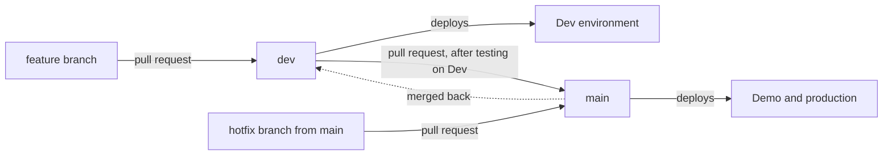

# Contributing to Pesqueiro.GG

This guide explains how the team works on Pesqueiro.GG: where work comes from, how branches and pull requests flow, and what "done" means.

## Before you start

- Read the [project board](https://github.com/orgs/Pesqueiro-GG/projects/1). Every piece of work is an issue there.
- Read [Pick up a backlog item](docs/how-to/pick-up-a-backlog-item.md).
- Read the [code conventions](docs/reference/code-conventions.md). AI assistants read the same rules through [AGENTS.md](AGENTS.md).

## Branches

Work flows from feature branches into `dev`, and from `dev` into `main`:



- Branch from `dev`. Name the branch after the item: `feat/s-09-log-a-catch`, `chore/t-03-databases`, `fix/s-11-feed-duplicates`, `docs/<topic>`.
- Open pull requests into `dev`. Only `dev` and hotfix branches merge into `main`.
- Never push directly to `dev` or `main`.

The full flow, environments and release steps are in [Environments](docs/reference/environments.md) and [Release to production](docs/how-to/release-to-production.md).

## Commits

Use [Conventional Commits](https://www.conventionalcommits.org) in English:

```
feat(logbook): log a catch with audience and idempotency
fix(social): skip hidden posts when hydrating feeds
docs: add the data model reference
```

Keep each commit focused. Don't commit secrets, `.env` files or personal data.

## Pull requests

- One backlog item per pull request. Split large items into smaller pull requests that each leave `dev` working.
- Write `Closes #<issue>` in the description.
- Fill in the [pull request template](.github/pull_request_template.md): what changed, how you tested it, and screenshots for UI changes.
- CI must pass. Pull requests into `main` also need one approval.

## Definition of done

An item is done when:

- Its acceptance criteria are met, with evidence in the pull request.
- Lint, types, module boundaries and all tests pass in CI.
- New text exists in Portuguese and English.
- Screens have loading, empty and error states and work at 360 px wide.
- No personal data appears in logs, errors or traces.
- Schema changes include a migration and its access policy.
- The docs are updated if a decision changed.
- It's merged into `dev` and checked on the Dev environment.

## Documentation

The `docs/` folder follows [Diátaxis](https://diataxis.fr). Put new pages in the section that matches what the reader needs:

| The reader wants to… | Section |
|---|---|
| learn by doing | `docs/tutorials/` |
| complete a specific task | `docs/how-to/` |
| look up a fact | `docs/reference/` |
| understand why | `docs/explanation/` |

Write in English, in second person, active voice and present tense, following the [Google developer documentation style guide](https://developers.google.com/style).
