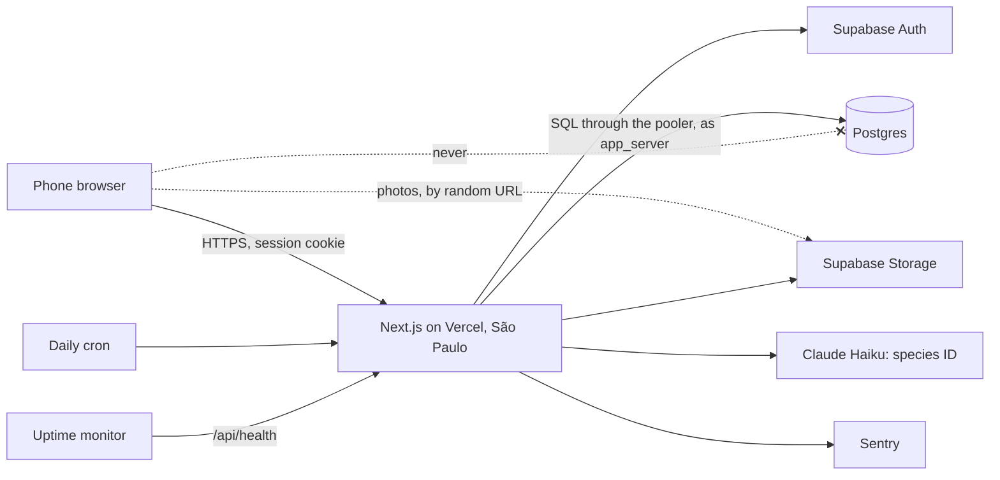
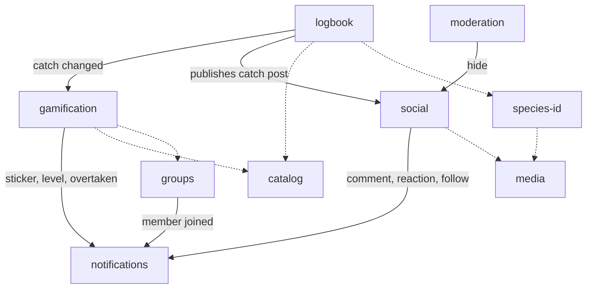
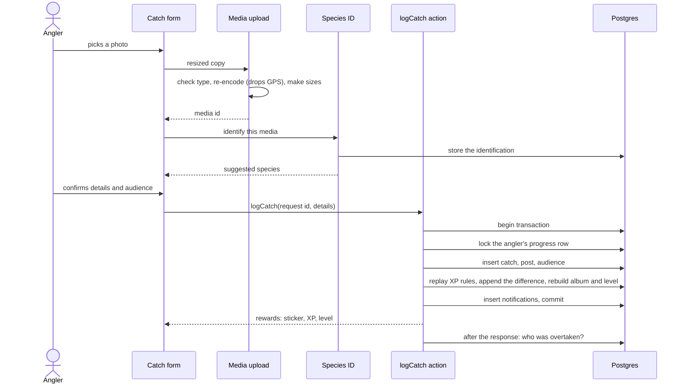
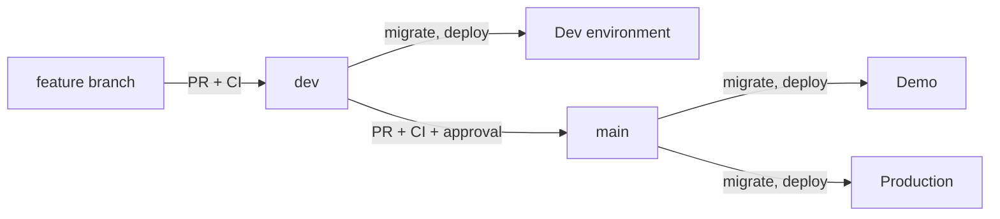

# Architecture

Pesqueiro.GG is a modular monolith: one Next.js application, split into modules that own their data and talk through small interfaces and in-process events. This page explains its shape and the main data flows. Exact tables are in the [data model](../reference/data-model.md); the reasons behind each choice are in the [decision records](decisions/README.md).

## The whole system

The browser holds a login session and loads photos from storage. It never queries the database: every read and write goes through server code, where the rules live. Row-level security denies the browser's public key access to every table as a second line of defense.

## Modules

| Module | Owns | Responsibility |
|---|---|---|
| identity | profiles | Profile, handle, language, title form, account deletion |
| groups | groups, members | Create, invite, join, leave, roles |
| catalog | species, places, municipalities | Reference data, rarity, protected flag |
| logbook | catches | The fishing record, including the private exact location |
| social | posts, audiences, comments, reactions, follows | Everything people see and interact with; feeds |
| gamification | XP ledger, album, progress, seasons, challenges | Rules, replay, rankings, challenges |
| notifications | notifications | Turns other modules' events into in-app notifications |
| moderation | reports, moderation actions | Reporting, hiding, review |
| media | media | Upload checks, re-encoding, sizes, cleanup |
| species-id | identifications, AI usage | Species suggestion from a stored photo |

Solid arrows are events, run inside the same database transaction. Dashed arrows are reads or calls through a module's `index.ts`.

## Logging a catch

The main journey touches most modules. Photo work happens before the catch exists; everything from the insert to the notifications commits together.

## Feeds

Every feed goes through `TimelineSource`, which returns post IDs and an opaque cursor, and `hydratePosts`, which loads the posts and checks the viewer may see each one. Today the IDs come from one indexed SQL query when the feed opens. [Feeds and the path to scale](scaling.md) explains why, and what changes as the app grows.

## Delivery

Migrations always run before the code that needs them is deployed. Environments, branch rules and variables are in [Environments](../reference/environments.md).

## Observability

Sentry holds errors, traces and logs, linked by one trace ID. Health checks, a daily-job heartbeat and an AI spending counter cover the rest, and every alert lands in Discord. Personal data never leaves the server. Details are in [Observability](../reference/observability.md).
