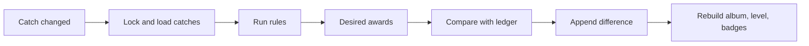

# Gamification

Why the XP system is built as an append-only ledger with full replay, and how its rules keep competition fair and fishing responsible. The exact numbers are in [XP, levels and rarity](../reference/xp-and-levels.md).

## What gets rewarded

XP comes only from fishing: logging catches, new species, new water types, milestones and challenge results. Posts, comments and reactions never award XP, so the progression can't become an engagement-farming game. Social recognition shows up as reactions and comments instead.

The rules reward **variety over volume**:

- New species are worth far more than repeat catches, scaled by rarity.
- Catch XP shrinks after the third catch of a day and stops after the sixth.
- No rule counts the weight or number of kept fish, and releasing a fish is neither rewarded nor penalized in XP. Groups can reward release through challenges if they want.
- Protected species never earn a rarity bonus, and keeping one earns nothing. Rarity comes from range, difficulty and stocking, never from conservation status, so the game never rewards going after threatened fish.
- In pay-to-fish lakes the rarity bonus stops at Incomum: a pintado stocked in a lake isn't rare.

## Why a ledger and replay

A naive design keeps counters and adds points as things happen. That breaks on the first edit: change a catch's species, delete your first tilápia, or back-date a catch, and the counters no longer match the history.

Pesqueiro.GG keeps every XP change as a row in an append-only ledger (`xp_events`). When a catch is logged, edited or deleted, the engine:

1. Locks the angler's progress row, so their saves run one at a time.
2. Loads all of the angler's catches, oldest first.
3. Runs every rule, as pure functions, producing the awards the angler *should* have.
4. Compares them with what the ledger already holds, per award key.
5. Appends only the difference, as positive or negative rows.
6. Rebuilds the album, level and badges from the result.

This works because people log about two or three catches a month. Replaying a few hundred catches costs almost nothing, and in return:

- **Order problems disappear.** Delete your first tilápia and the next one becomes the "new species" catch on its own.
- **Edits are exact and visible.** Changing a species appends a minus and a plus; nothing is overwritten.
- **Retries are harmless.** Each replay that changes anything gets the angler's next sequence number, and the ledger is unique on (angler, award key, sequence), so a retried replay finds nothing to add.
- **Rules can change.** Bump the ruleset version and replay everyone; the ledger shows exactly what changed.

Award keys name *what* was earned (`species:tucunare-acu`), not which catch earned it, so an award can move between catches without being counted twice. An earlier design made the ledger unique on the catch's revision. That broke when an award moved from one catch to another that hadn't changed itself, which is why the sequence number belongs to the angler. See [ADR-013](decisions/ADR-013-replay-sequence.md).

## Rarity rubric

A species' rarity tier comes from three scores, never from opinion at the time of a catch:

- **Criteria** (range), 0 to 2.
- **Difficulty**, 0 to 2.
- **Stocking**, -1 to 0.

The tier is derived from their sum: 1 or less is `comum`, 2 is `incomum`, 3 is `raro`, 4 is `epico`.

The scores live in `src/modules/catalog/data/species.json`. They are not database columns: the seed derives the tier and stores it in `species.rarity_tier`. Protected species get the `is_protected` flag, and XP ignores their tier.

Sources:

- Distribution comes from FishBase. Its content is CC BY-NC, so credit it.
- The threatened flag comes from MMA Portaria 148/2022.

AI may draft entries, but a person checks each one and fills `reviewed_by` and `reviewed_at`. Entries with those fields empty are not yet reviewed.

Album numbers are assigned once, ordered by habitat, then family, then `name_pt`. They never change after that, so a species added later takes the next number.

## Rankings people can trust

A group's season ranking counts only XP from catches the group can see: shared with the group, or public. A catch shared only with one group doesn't move another group's ranking. Your score can therefore differ between groups, but every point in a ranking is something its members can check by scrolling their feed.

## The rhythm

Seasons are calendar quarters, which suits people who fish a few times a month and gives rankings time to fill. Monthly challenges add a shorter, fresh competition inside each season, so someone who joins mid-season still has something to win.

## Proof grows with the audience

Logging a catch needs no proof: friends who fish together trust each other and call out exaggerations. Public challenges, where strangers compete, accept only catches whose stored photo the AI matched to the chosen species, flag photos reused across accounts, and let reports freeze an entry. Prize competitions, if they come later, would add manual review. More in [Privacy and trust](privacy-and-trust.md).
