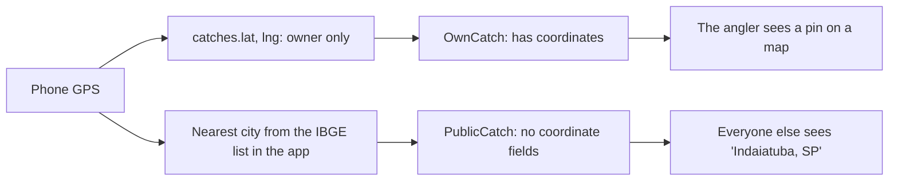

# Privacy and trust

Fishing spots are secrets, rankings need to be believable, and a public feed needs a way to deal with abuse. This page explains how the design handles each.

## Location privacy

Anglers guard their spots. Pesqueiro.GG treats an exact location as something only its owner ever sees.

- The exact point is stored on the catch for the angler's own log.
- Everyone else receives a different data type with no coordinate fields at all. A test fails if coordinates ever reach it.
- The city comes from Brazil's municipality list stored inside the app, so no outside geocoding service ever sees a location.
- Only commercial pay-to-fish lakes are shown by name; they're public businesses.
- Every photo is re-encoded on the server, which removes the GPS position phone cameras embed.

## Visibility

Every post has an audience: some of the author's groups, and optionally the public. Every read checks it, and content outside your audience returns "not found" rather than "forbidden", so nobody can probe whether a private catch exists.

## Proof levels

| Where a result travels | Proof required |
|---|---|
| Your groups | None. Friends trust each other. |
| The public feed | None, but anyone can report. |
| Public challenges | Photo with an AI species match, a reused-photo check, and reports that can freeze an entry. |
| Prize contests (later) | Manual review |

The AI result is stored on the server when the photo is identified. The browser never sends it, so it can't be forged. A perceptual hash of each photo catches the same picture on two accounts, even resized or screenshotted.

## Moderation

- Anyone can report a post, comment or profile once.
- Three counted reports hide the item until review. Only reports from accounts at least 3 days old with a logged catch count, so a handful of throwaway accounts can't hide someone's posts.
- Platform admins review a queue and restore or remove content. Group admins can remove posts from their own group.
- Every moderation action is recorded with who did it.

## Personal data

Real users' data falls under Brazil's data protection law (LGPD). The app collects only what it needs, explains it in a plain privacy notice, keeps personal data out of logs and monitoring, and lets anyone delete their account and everything tied to it. The judged demo runs in a separate environment with invented data, so no real person ever appears in it.
