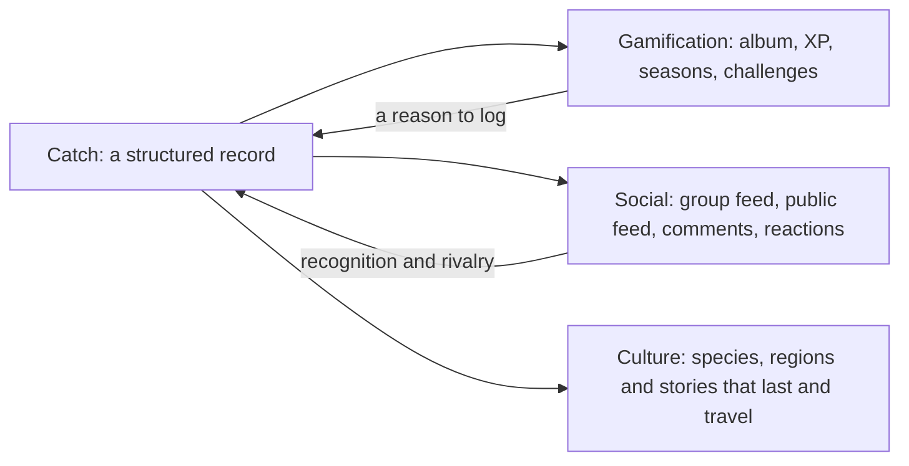

# Product

What Pesqueiro.GG is for, who it serves, and what's deliberately out of scope.

## The problem

Recreational fishing is one of Brazil's most widespread social traditions. The culture it produces (catch stories, regional species, techniques, local spots, rivalries between friends) lives in WhatsApp groups and generic social feeds. There, it vanishes in the scroll, can't be searched, never adds up to anything, and never reaches beyond the group.

The earlier version of Pesqueiro.GG, a private app for one group of about a dozen friends, showed what keeps people engaged: the ranking. Competing inside a group of people who know each other worked. It also showed that people fish rarely, about two or three catches a month each, so anything built for daily habits would fail.

## The idea

On Instagram, a catch is a photo. On Pesqueiro.GG, a catch is a record: one post fills your species album, moves your group's ranking, counts in challenges, and adds to your region's fishing story.

Each pillar takes from the catch and gives a reason to log the next one.

## Who it's for

All recreational anglers (pay-to-fish lakes, rivers, reservoirs, the sea), arriving through groups of people who already fish together. The person who brings a group in is the *group captain*: the friend who organizes trips and keeps score. One captain brings in 5 to 15 people with one WhatsApp link.

## Core journeys

| Id | Journey |
|---|---|
| J1 | A captain creates a group and shares an invite on WhatsApp; a friend joins in under a minute. |
| J2 | Log a catch: photo, AI species suggestion, details, audience, then a sticker fills, XP rises and the group ranking moves. |
| J3 | A group admin creates a challenge from a template; members compete on its leaderboard. |
| J4 | Friends react and comment; the owner is notified. |
| J5 | A public catch appears in the public feed; someone outside the group follows the angler. |
| J6 | An angler enters the official public challenge, where photo proof is required. |
| J7 | A shared catch link shows a rich preview in WhatsApp and invites the visitor to join. |

## Principles

- **XP rewards fishing, not scrolling.** Social actions never award XP.
- **Variety over volume.** Rarity and new species matter more than catching a lot, which also avoids rewarding keeping more fish.
- **Proof grows with the audience.** Logging is free; strangers competing need photo proof.
- **Fishing spots are secrets.** Others see a city or a pay-to-fish lake's name, never coordinates.
- **Weekly and monthly rhythm.** Quarterly seasons and monthly challenges, not daily streaks.

## Hackathon track

Pesqueiro.GG competes in **Cultura & Economia Criativa**, whose examples include social networks and creative communities. The problem it solves (fishing culture disappearing in chats) and its audience (the people who create that content) sit inside the track. Gamification is the engine that gets the culture documented and shared.

## Scope for the hackathon

The backlog's milestones define what's built: accounts and groups, catch logging with species ID, the XP engine, album, levels, seasons, challenges, feeds, posts and tips, comments and reactions, notifications, reporting, both languages, privacy and legal notices, and a separate demo environment.

## Out of scope

Pesqueiro.GG is not a cultural archive, a course platform, a marketplace, an environmental monitoring tool, a map of fishing spots, or a generic social network. For the hackathon, it also excludes video, direct messages, prizes, regional closed-season calendars, native apps, friend requests, algorithmic feed ranking, ads and translation of user content.
