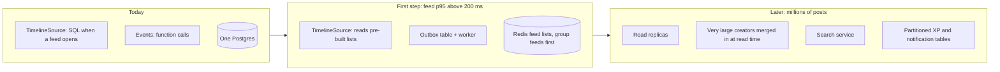

# Feeds and the path to scale

Why feeds are built when someone opens them instead of being pre-built, and how the design lets that change later without a rewrite.

## How feeds work today

When you open a feed, one indexed query returns the next 20 post IDs older than your cursor, and a second step loads those posts and re-checks that you may see each one. Nothing is copied into per-person feed tables.

At Pesqueiro.GG's expected size this is the right trade-off. A rough estimate at 100,000 active anglers: about 0.2 posts written per second on average and 3 to 4 feed loads per second, with weekend peaks around 5 and 50. A single Postgres database answers thousands of indexed queries per second.

Building feeds at read time also keeps them correct for free. Pre-built feeds have to undo copies whenever a post is deleted, hidden or has its audience changed, and fill in someone's timeline when they follow a new person. Those are the hardest parts of large feed systems, and none of them apply here.

## The seams that make growth a swap

Five things are built now so that later steps replace one part instead of rewriting many:

1. **Feeds return IDs, then fill them in.** `TimelineSource.page(viewer, feed, cursor)` returns post IDs and a cursor; `hydratePosts(ids, viewer)` loads and checks them. Pre-built feeds later replace only `TimelineSource`.
2. **Opaque cursors.** The phone sends back a token it never reads, so pagination can change underneath.
3. **The events a feed worker would need already exist:** post published, hidden, deleted, audience changed, followed, unfollowed.
4. **Stateless app servers.** Vercel already spreads requests across instances; Postgres is the only shared part.
5. **Measured from day one.** Feed query time is logged, so the decision to change is made on data.

## The stages

| Area | Today | Change when | Then |
|---|---|---|---|
| Feeds | Built on read behind `TimelineSource` | Feed p95 above 200 ms, or many people following 2,000+ accounts | A worker fills feed lists from an outbox, group feeds first. Accounts with very large followings stay read-time and are merged in. |
| Rankings | One SQL query per group and season, cached | Groups in the hundreds, or public rankings by state | Stored score tables updated from the ledger |
| XP | Full replay per angler inside the save | Anglers with thousands of catches | Replay from a checkpoint, or in a background job |
| Events | In-process, same transaction | Writes slow down, or outside integrations appear | Outbox table and a worker |
| Notifications | Checked every 60 seconds | Real-time becomes part of the product | Supabase Realtime or web push |
| Search | Postgres text search | Search gets slow or needs relevance ranking | A dedicated search service |
| Media | Supabase Storage, sizes made on upload | Bandwidth costs grow | A CDN in front, or an image service |

Through every stage, the code that calls feeds, events and posts stays the same.
