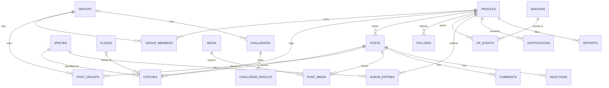

# Data model

Every table, the module that owns it, and its key constraints. Only the owning module writes to a table. All tables have row-level security on with access for the `app_server` role only.

This page describes the design. When the code and this page disagree, fix whichever is wrong in the same pull request.

## Entity overview

## Tables by module

### identity

| Table | Columns | Constraints and notes |
|---|---|---|
| `profiles` | `id` (= auth user id), `handle`, `display_name`, `avatar_media_id`, `home_state`, `home_city_id`, `show_home_city`, `locale` (`pt-BR` \| `en`), `title_form` (`m` \| `f`), `terms_version`, `terms_accepted_at`, `created_at`, `deleted_at` | `handle` unique, lowercase, `^[a-z0-9_]{3,20}$` |
| `platform_admins` | `user_id` | Grants the admin review and impact pages |

### groups

| Table | Columns | Constraints and notes |
|---|---|---|
| `groups` | `id`, `name`, `description`, `invite_code`, `created_by`, `created_at` | `invite_code` unique, 8 characters from an unambiguous alphabet |
| `group_members` | `group_id`, `user_id`, `role` (`admin` \| `member`), `joined_at` | Primary key (`group_id`, `user_id`); index on `user_id`; at most 200 members |

### catalog

| Table | Columns | Constraints and notes |
|---|---|---|
| `species` | `id` (slug), `album_no`, `scientific_name`, `name_pt`, `name_en`, `aliases_pt`, `habitat`, `rarity_tier`, `is_protected`, `protection_note_pt`, `protection_note_en`, `sources`, `reviewed_by`, `reviewed_at` | `album_no` unique and never changed once assigned |
| `places` | `id`, `name`, `kind` (`pay_to_fish`), `city_id`, `state`, `lat`, `lng`, `created_by`, `created_at` | Only commercial pay-to-fish lakes. Wild spots are never places. |

Brazilian municipalities are a static file (`src/modules/catalog/data/municipalities.json`, IBGE code, name, UF, centroid), not a table.

### logbook

| Table | Columns | Constraints and notes |
|---|---|---|
| `catches` | `id`, `user_id`, `species_id` (null = unknown), `caught_on`, `weight_g`, `length_mm`, `water_type` (`pay_to_fish` \| `river` \| `reservoir_lake` \| `sea`), `released`, `place_id`, `city_id`, `lat`, `lng`, `verification_level` (`reported` \| `photo_ai_match`), `duplicate_photo`, `revision`, `client_request_id`, `created_at`, `updated_at`, `deleted_at` | Unique (`user_id`, `client_request_id`). `lat` and `lng` reach the owner only. `revision` increments on every edit (optimistic concurrency). Index (`user_id`, `caught_on`). |

### social

| Table | Columns | Constraints and notes |
|---|---|---|
| `posts` | `id`, `author_id`, `kind` (`catch` \| `story` \| `tip`), `catch_id`, `title`, `body`, `tip_category`, `tip_species_id`, `tip_place_id`, `link_url`, `is_public`, `reaction_count`, `comment_count`, `created_at`, `hidden_at`, `deleted_at` | `catch_id` unique. Partial index on public posts (`created_at desc, id`) where visible. Index (`author_id`, `created_at desc`). |
| `post_groups` | `post_id`, `group_id`, `post_created_at` | The audience. Index (`group_id`, `post_created_at desc`, `post_id`). |
| `post_media` | `post_id`, `media_id`, `position` | |
| `comments` | `id`, `post_id`, `author_id`, `body`, `created_at`, `hidden_at`, `deleted_at` | `body` 1–1,000 characters. Index (`post_id`, `created_at`). |
| `reactions` | `post_id`, `user_id`, `created_at` | Primary key on both: one reaction per person per post |
| `follows` | `follower_id`, `followee_id`, `created_at` | Primary key on both; index on `followee_id` |
| `share_opens` | `post_id`, `day`, `count` | Signed-out opens of shared links. No IP or user agent. |

### media

| Table | Columns | Constraints and notes |
|---|---|---|
| `media` | `id`, `owner_id`, `path_prefix`, `width`, `height`, `bytes`, `phash`, `status`, `attached_at`, `created_at` | Files in bucket `media` at `<random uuid>/<width>.webp`. Unattached rows older than 24 hours are deleted daily. |

### species-id

| Table | Columns | Constraints and notes |
|---|---|---|
| `species_identifications` | `media_id`, `model`, `is_fish`, `top_species_id`, `confidence`, `alternatives`, `created_at` | `media_id` unique: one identification per photo |
| `ai_usage` | `month`, `calls`, `alerted_80` | Monthly cap and the 80% alert |

### gamification

| Table | Columns | Constraints and notes |
|---|---|---|
| `seasons` | `id` (`2026-Q4`), `starts_at`, `ends_at` | Calendar quarters in Brasília time |
| `xp_events` | `id`, `user_id`, `season_id`, `rule`, `amount`, `award_key`, `source_type` (`catch` \| `challenge`), `source_id`, `replay_seq`, `ruleset_version`, `created_at` | **Append-only:** `app_server` has no update or delete rights. Unique (`user_id`, `award_key`, `replay_seq`). Indexes (`user_id`, `season_id`) and (`source_id`). |
| `user_progress` | `user_id`, `lifetime_xp`, `level`, `level_seen`, `species_count`, `water_types`, `replay_seq`, `updated_at` | Rebuilt by every replay. Its row is locked during a save. |
| `album_entries` | `user_id`, `species_id`, `first_catch_id`, `first_caught_on`, `best_catch_id`, `best_weight_g`, `catch_count`, `seen_at` | Rebuilt by every replay |
| `user_badges` | `user_id`, `badge_id`, `earned_at`, `source_catch_id` | Rebuilt by every replay |
| `ranking_seen` | `user_id`, `group_id`, `season_id`, `position`, `seen_at` | Movement arrows since the last visit |
| `challenges` | `id`, `scope` (`group` \| `official`), `group_id`, `created_by`, `template`, `title`, `params`, `starts_on`, `ends_on`, `min_verification`, `status`, `finalized_at`, `created_at` | `params` validated by the template's schema |
| `challenge_participants` | `challenge_id`, `user_id`, `joined_at` | Official challenges only |
| `challenge_results` | `challenge_id`, `user_id`, `rank`, `score` | Snapshot written once at finalization |

### notifications

| Table | Columns | Constraints and notes |
|---|---|---|
| `notifications` | `id`, `recipient_id`, `type`, `actor_id`, `subject_type`, `subject_id`, `data`, `created_at`, `read_at` | Stored as type plus data, rendered in the reader's language. Index (`recipient_id`, `created_at desc`). Deleted after 90 days. |

### moderation

| Table | Columns | Constraints and notes |
|---|---|---|
| `reports` | `id`, `reporter_id`, `subject_type`, `subject_id`, `reason`, `note`, `counted`, `created_at`, `resolved_at`, `resolution` | Unique (`reporter_id`, `subject_type`, `subject_id`). Counted only from accounts at least 3 days old with a catch. |
| `moderation_actions` | `id`, `actor_id`, `action`, `subject_type`, `subject_id`, `group_id`, `reason`, `created_at` | Append-only audit trail |

### Shared

| Table | Columns | Constraints and notes |
|---|---|---|
| `rate_limits` | `key`, `window_start`, `count` | Primary key on both. Old windows deleted daily. |
| `pending_deletions` | `path`, `created_at` | Storage files to delete after an account deletion, retried daily |
| `feedback` | `id`, `user_id`, `body`, `media_id`, `created_at` | Beta feedback |

## Deleting an account

Every user-owned table references `profiles(id)` with `on delete cascade`. Actor columns in `notifications` and `moderation_actions` use `on delete set null`. Postgres runs cascades with the owner's rights, so the XP ledger's rows go too, even though `app_server` can't delete them directly.
